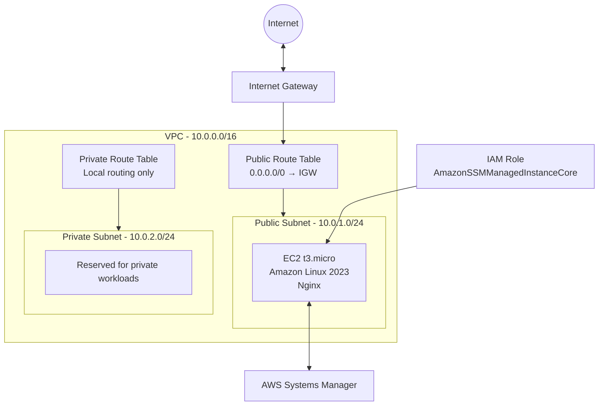

# AWS Infrastructure Provisioning with Terraform

A modular Infrastructure as Code project that provisions a small AWS environment using Terraform.

The project creates a custom VPC, public and private subnets, internet routing, an EC2 instance running Nginx, Security Groups, and IAM integration with AWS Systems Manager.

The entire infrastructure can be created and destroyed reproducibly using Terraform without manual resource creation in the AWS Console.

## Architecture



The EC2 instance is deployed in the public subnet and receives a public IPv4 address.

The private subnet has no direct Internet route and no NAT Gateway.

The EC2 instance uses an IAM role to register with AWS Systems Manager, allowing remote management without exposing SSH port 22.

## Demo

The EC2 instance automatically installs and starts Nginx through a user-data script.

The deployed page returns:

```text
AWS Terraform Demo

Infrastructure provisioned with Terraform.
Running on Amazon EC2 with Nginx.
```

The deployment was verified with an HTTP `200 OK` response from Nginx.


## Technologies

- Terraform
- AWS
  - VPC
  - EC2
  - IAM
  - Systems Manager
  - Systems Manager Parameter Store
  - Subnets
  - Internet Gateway
  - Route Tables
  - Security Groups
- Amazon Linux 2023
- Nginx
- Bash
- Git

## Project Structure

```text
terraform-aws-infrastructure/
├── .gitignore
├── .terraform.lock.hcl
├── main.tf
├── outputs.tf
├── providers.tf
├── variables.tf
│
└── modules/
    ├── networking/
    │   ├── main.tf
    │   ├── outputs.tf
    │   ├── routes.tf
    │   └── variables.tf
    │
    └── compute/
        ├── iam.tf
        ├── main.tf
        ├── outputs.tf
        ├── security.tf
        ├── user-data.sh
        └── variables.tf
```

## Terraform Modules

### Networking Module

The `networking` module provisions the AWS networking layer:

- VPC with DNS support
- Public subnet
- Private subnet
- Internet Gateway
- Public route table
- Private route table
- Route table associations

The public and private subnets are placed in separate Availability Zones.

### Compute Module

The `compute` module provisions:

- Amazon EC2 instance
- Security Group
- HTTP ingress rule
- Outbound IPv4 access
- IAM role
- IAM instance profile
- Systems Manager permissions
- Amazon Linux 2023 AMI lookup
- Nginx installation through EC2 user data

The modules communicate through Terraform inputs and outputs rather than directly referencing resources inside each other.

## Networking

The VPC uses the following address space:

```text
VPC
10.0.0.0/16

├── Public Subnet
│   10.0.1.0/24
│
└── Private Subnet
    10.0.2.0/24
```

The public subnet uses the route:

```text
0.0.0.0/0 → Internet Gateway
```

The private subnet only has local VPC routing.

A NAT Gateway is intentionally not created in order to keep the architecture small and avoid unnecessary AWS costs.

## Security

The web server Security Group allows:

```text
Inbound:
TCP 80    0.0.0.0/0

Outbound:
All IPv4  0.0.0.0/0
```

SSH access on TCP port 22 is intentionally not enabled.

The EC2 instance also requires IMDSv2 for access to instance metadata:

```hcl
metadata_options {
  http_tokens = "required"
}
```

This project uses HTTP only for demonstration purposes. A production deployment should use HTTPS and stricter network controls where appropriate.

## IAM and Systems Manager

The EC2 instance receives AWS permissions through an IAM role instead of hardcoded access keys.

The IAM architecture is:

```text
EC2
 │
 ▼
IAM Instance Profile
 │
 ▼
IAM Role
 │
 ▼
AmazonSSMManagedInstanceCore
 │
 ▼
AWS Systems Manager
```

The role trust policy allows the EC2 service to assume the role.

The AWS-managed `AmazonSSMManagedInstanceCore` policy provides the permissions required for the Systems Manager agent to communicate with AWS Systems Manager.

The configuration was verified by confirming that the EC2 instance registered successfully as an online Systems Manager managed node.

Example result:

```json
{
  "PingStatus": "Online",
  "Platform": "Amazon Linux"
}
```

This provides a safer management path than exposing SSH directly to the Internet.

## Dynamic AMI Discovery

The Amazon Linux 2023 AMI ID is not hardcoded.

Terraform retrieves the current AMI through AWS Systems Manager Parameter Store:

```text
/aws/service/ami-amazon-linux-latest/al2023-ami-kernel-default-x86_64
```

This avoids manually updating AMI IDs when AWS publishes newer Amazon Linux images.

## Automated Server Provisioning

The EC2 instance uses a Bash `user_data` script during its initial boot.

The script:

1. Installs Nginx
2. Creates the demo HTML page
3. Enables the Nginx service
4. Starts the web server

No manual SSH configuration is required to deploy the application.

## Requirements

Before deploying the infrastructure, ensure that you have:

- Terraform
- AWS CLI
- An AWS account
- AWS credentials with sufficient permissions

The default region used by this project is:

```text
eu-north-1
```

## AWS Authentication

AWS credentials are not stored in this repository.

Authenticate using an AWS CLI profile:

```bash
aws login --profile terraform-lab
```

Expose the profile to Terraform:

```bash
export AWS_PROFILE=terraform-lab
```

Verify that authentication is working:

```bash
aws sts get-caller-identity
```

Terraform will automatically use the credentials associated with the selected AWS CLI profile.

## Deployment

Clone the repository:

```bash
git clone <repository-url>
cd terraform-aws-infrastructure
```

Initialize Terraform:

```bash
terraform init
```

Format the configuration:

```bash
terraform fmt -recursive
```

Validate it:

```bash
terraform validate
```

Review the infrastructure changes:

```bash
terraform plan
```

Create the infrastructure:

```bash
terraform apply
```

After deployment, retrieve the outputs:

```bash
terraform output
```

Retrieve the web server URL directly:

```bash
terraform output -raw website_url
```

The EC2 instance may require a short amount of time after creation for the user-data script to install and start Nginx.

## Verification

Verify the Nginx deployment:

```bash
curl "$(terraform output -raw website_url)"
```

Verify that the EC2 instance is registered with AWS Systems Manager:

```bash
INSTANCE_ID=$(terraform output -raw instance_id)

aws ssm describe-instance-information \
  --filters "Key=InstanceIds,Values=$INSTANCE_ID" \
  --region eu-north-1
```

A successfully registered instance should report:

```text
PingStatus: Online
```

## Destroying the Infrastructure

All resources created by Terraform can be removed with:

```bash
terraform destroy
```

Always review the destruction plan before confirming.

The infrastructure lifecycle is:

```text
Terraform configuration
        │
        ▼
terraform plan
        │
        ▼
terraform apply
        │
        ▼
AWS Infrastructure
        │
        ▼
terraform destroy
```

## Terraform State

Terraform uses state to track the infrastructure it manages.

Local state files are excluded from Git:

```text
*.tfstate
*.tfstate.*
```

The Terraform working directory is also excluded:

```text
.terraform/
```

The provider dependency lock file is committed:

```text
.terraform.lock.hcl
```

This keeps provider versions reproducible without publishing Terraform state.

## Cost Considerations

This project may create AWS resources that consume credits or incur charges, including:

- EC2 compute
- EBS storage
- Public IPv4 address usage
- Data transfer

A NAT Gateway, Load Balancer, RDS database, and Auto Scaling Group are intentionally not included.

The goal is to demonstrate the core AWS and Terraform concepts without making the environment unnecessarily expensive.

Resources should be destroyed when the lab is not in use:

```bash
terraform destroy
```