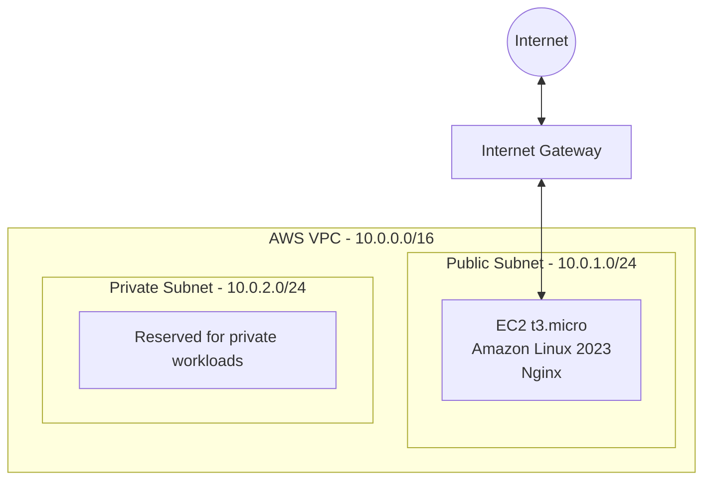

# AWS Infrastructure Provisioning with Terraform

A modular Infrastructure as Code (IaC) project that provisions a small AWS environment using Terraform.

The infrastructure includes a custom VPC, public and private subnets, internet routing, security groups, and an Amazon EC2 instance running Nginx.

All resources are provisioned automatically through Terraform without manual configuration in the AWS Console.

## Technologies

- AWS (VPC, EC2, IAM, Security Groups)
- Terraform
- Amazon Linux 2023
- Bash
- Nginx
- Git

## Architecture



The public subnet has a default route to the Internet Gateway.

The private subnet has no direct internet route or NAT Gateway.

Inbound access to the EC2 instance is restricted to HTTP (TCP port 80). SSH access is not enabled.

## Project Structure

```text
terraform-aws-infrastructure/
├── .gitignore
├── .terraform.lock.hcl
├── main.tf
├── providers.tf
├── variables.tf
├── outputs.tf
└── modules/
    ├── networking/
    │   ├── main.tf
    │   ├── routes.tf
    │   ├── variables.tf
    │   └── outputs.tf
    └── compute/
        ├── main.tf
        ├── security.tf
        ├── variables.tf
        ├── outputs.tf
        └── user-data.sh
```

## Terraform Modules

### Networking Module

Provisions the foundational AWS networking resources:

- VPC with DNS support
- Public and private subnets across two Availability Zones
- Internet Gateway
- Public and private route tables
- Route table associations

### Compute Module

Provisions the application infrastructure:

- EC2 instance running Amazon Linux 2023
- Security Group with HTTP ingress
- Outbound IPv4 access
- Automated Nginx installation using EC2 user data

Both modules expose outputs that can be referenced by the root Terraform configuration.

## Prerequisites

Before deployment, ensure you have:

- An AWS account with appropriate permissions
- Terraform installed
- AWS CLI installed
- Valid AWS authentication credentials

The example configuration uses the AWS Stockholm region (`eu-north-1`).

Configure AWS authentication:

```bash
aws login --profile terraform-lab
```

Select the profile for Terraform:

```bash
export AWS_PROFILE=terraform-lab
```

For fish shell:

```fish
set -gx AWS_PROFILE terraform-lab
```

## Deployment

### 1. Clone the repository

```bash
git clone <repository-url>
cd terraform-aws-infrastructure
```

Replace `<repository-url>` with the actual GitHub repository URL.

### 2. Initialize Terraform

```bash
terraform init
```

### 3. Format and validate

```bash
terraform fmt -check -recursive
terraform validate
```

### 4. Review infrastructure changes

```bash
terraform plan
```

### 5. Deploy

```bash
terraform apply
```

Review the execution plan and confirm the deployment.

### 6. Retrieve outputs

```bash
terraform output
```

To retrieve the Nginx URL:

```bash
terraform output -raw website_url
```

The Nginx web server is automatically installed during the initial EC2 boot process.

It may take a few minutes for the website to become available.

## Security Considerations

The project includes several basic security practices:

- No inbound SSH access
- HTTP access restricted to TCP port 80
- IMDSv2 required for EC2 metadata access
- Temporary AWS CLI credentials
- Terraform state files excluded from version control
- No hardcoded AWS access keys
- Standard EC2 CPU credit mode to avoid Unlimited-mode CPU credit charges

HTTP is used only for this demonstration. Production deployments should use HTTPS and a suitable TLS termination setup.

## Cost Considerations

This project creates AWS resources that may consume credits or incur charges, including:

- EC2 compute
- EBS storage
- Public IPv4 addresses
- Data transfer

Review the applicable AWS pricing and Free Tier eligibility before deployment.

To delete the infrastructure:

```bash
terraform destroy
```

Confirm the destruction plan before proceeding.

Verify that no unexpected billable resources remain in your AWS account.

## Key Concepts Demonstrated

- Infrastructure as Code
- Declarative infrastructure management
- Modular Terraform architecture
- AWS VPC networking
- Infrastructure dependencies
- Parameterized configurations
- Terraform state management
- Automated server provisioning
- Infrastructure lifecycle management

## Future Improvements

Potential extensions include:

- Remote Terraform state storage
- CI validation using GitHub Actions
- HTTPS support
- Additional monitoring and observability

These extensions are outside the current project scope.

## Author

Nikolas Rerras
